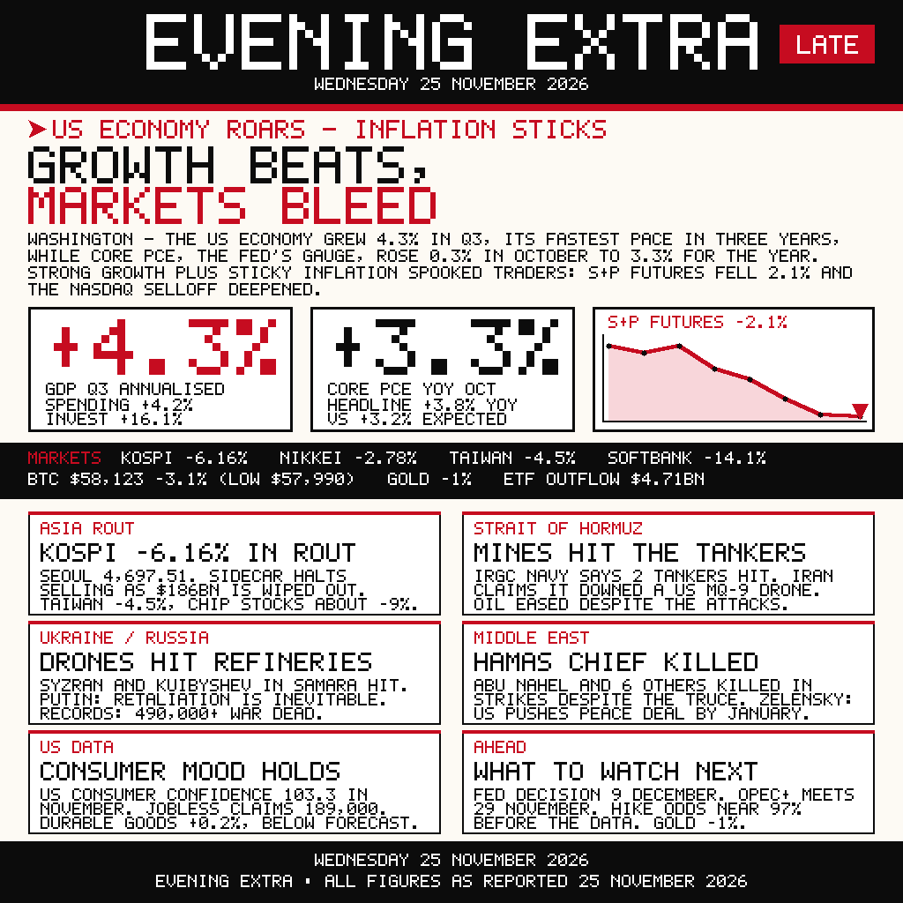

[](https://make.fun/bounty/news-image-20261125?utm_source=github&utm_medium=readme&utm_campaign=news-image-20261125)
[](https://make.fun/bounty/news-image-20261125/leaderboard?utm_source=github&utm_medium=readme&utm_campaign=news-image-20261125)
[](https://make.fun/bounty/news-image-20261125?utm_source=github&utm_medium=readme&utm_campaign=news-image-20261125)

# The World in One Image — Wednesday 25 November 2026 (v2)



## About

An "EVENING EXTRA" red-top tabloid front page summarising the world news of
Wednesday 25 November 2026, drawn entirely by an original Node 22 program
(`main.ts`, stdlib only — its own rasterizer, hand-authored 5×7 bitmap font,
drawn illustrations, and deterministic PNG encoder). No packages, no network,
no image assets.

This is the second version for the day: the morning edition (v1) was a
navy-gold "morning ledger"; this evening edition is rebuilt from scratch in a
bold tabloid style with the day's US data releases as the lead.

## The day's stories

- **Lead — Growth beats, markets bleed:** US Q3 GDP grew **+4.3%**
  annualised (BEA second estimate, vs +3.5% expected and +3.4% advance —
  fastest in three years; consumer spending +4.2%, business investment
  +16.1%). Core PCE, the Fed's gauge, rose **+0.3% MoM / +3.3% YoY** in
  October (vs +3.2% expected — sticky inflation). Headline PCE +0.3% MoM /
  +3.8% YoY. S&P 500 futures fell 2.1% after the release; the Nasdaq selloff
  continued.
- **Asia rout:** Kospi **-6.16%** to 4,697.51 (circuit-breaker sidecar
  triggered, ~$186bn wiped); Nikkei -2.78% to 57,011.62; Taiwan -4.5%;
  SoftBank -14.1%; Samsung / SK Hynix about -9%.
- **Crypto:** Bitcoin ~**$58,123**, -3.1% on the day (low $57,990); US spot
  BTC ETFs saw record November outflows of ~$4.71bn, a sixth straight day of
  outflows ($232m Tuesday).
- **Strait of Hormuz:** tankers hit by mines (IRGC Navy says 2; other reports
  say more); Iran claims it shot down a US MQ-9 drone over the strait; oil
  eased despite the attacks.
- **Ukraine / Russia:** Ukrainian drones hit two Rosneft refineries in Samara
  (Syzran and Kuibyshev); Putin ordered stronger protection for energy sites
  and said retaliation is inevitable; Russian drones violated Polish airspace;
  leaked death records point to 490,000+ Russian war deaths; Zelensky says
  Washington is pushing for peace-deal progress by January.
- **Middle East:** Hamas internal security chief Abu Nahel and 6 others killed
  in strikes despite the truce.
- **US data:** consumer confidence 103.3 in November; jobless claims 189,000;
  durable goods orders +0.2% (vs +0.5% expected); consumer spending +0.3% in
  October; personal income +0.7%.
- **Ahead:** Fed decision 9 December · OPEC+ meets 29 November · December Fed
  hike odds near 97% before the data.

## Run

```sh
node main.ts
# writes entry.png (1024x1024) to $MAKEFUN_OUTPUT_DIR, default ./out
```

Two runs produce byte-identical output (verified by sha256).
